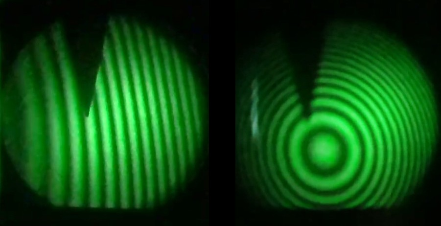
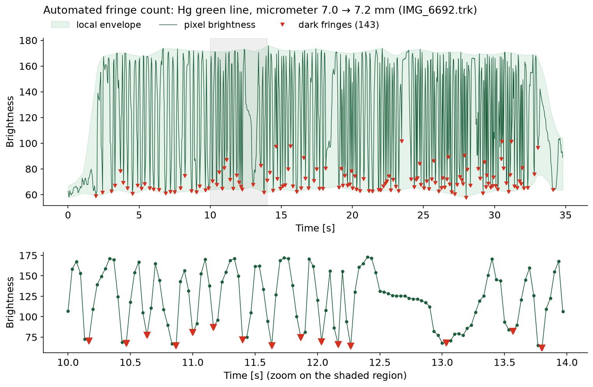
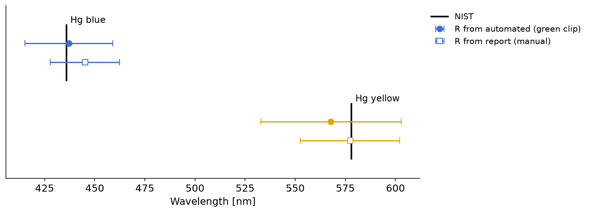

# Michelson Interferometer: Automated Fringe Counting

**Measuring the wavelengths of mercury lines by letting a phone camera count the interference fringes.**

<p align="center">
  
</p>
<p align="center"><sub>Fringes of the mercury green line recorded in the lab: equal thickness (left) and equal inclination (right). The triangle is a fixed marker.</sub></p>

In a Michelson interferometer, moving one mirror by a distance *d* sweeps *N* dark fringes past any point of the pattern, where **2d = Nλ**. Counting hundreds of fringes by eye is slow and error-prone. So instead I filmed the pattern while turning the micrometer, tracked the brightness of a single pixel in [Tracker](https://physlets.org/tracker/), and counted the dark fringes in software.

This repository turns that method into a reproducible pipeline. It reads the original Tracker files, counts the fringes automatically, calibrates the interferometer's lever, and measures the wavelengths.

## Results

| Line | This analysis | NIST | 2019 report |
|---|---|---|---|
| Hg blue | **437 ± 22 nm** | 435.8 nm | 426 ± 10 nm |
| Hg yellow (doublet mean) | **568 ± 35 nm** | 578.0 nm | 580 ± 10 nm |
| Reduction factor *R* | **0.196 ± 0.009** | – | 0.1992 ± 0.0007 |

Both wavelengths agree with the NIST values within one standard deviation. The reduction factor here is calibrated from the green clip with the same automated counter, so any bias in the counting partly cancels between calibration and measurement.

<p align="center">
  
</p>

The counter finds **143 dark fringes** in the green calibration clip; Origin's Peak Analyzer found 142 in the original report. The zoom shows how it copes with the moment the micrometer was paused (around 12.5 s): no fringes pass, and none are counted.

<p align="center">
  
</p>

## Try it

```bash
git clone https://github.com/simonatodorova/michelson-interferometer.git
cd michelson-interferometer
pip install -r requirements.txt
python -m michelson          # prints every count and the wavelengths, writes results/
pytest                       # tests
```

The whole analysis runs in about a second. The Tracker files it needs (3 MB) are in [`data/tracker`](data/tracker); the original videos are not included.

## How the counter works

[`michelson/fringes.py`](michelson/fringes.py):

1. **Brightness**: read the RGB values Tracker stored for the tracked pixel in every frame and convert them to luma ([`tracker.py`](michelson/tracker.py)).
2. **Local envelope**: compute a running minimum and maximum. Brightness and fringe contrast drift during a clip, so a single global threshold (the mean, as in the original Origin analysis) misses low-contrast fringes. Normalising to the local envelope fixes that.
3. **Moving frames only**: skip frames where the envelope collapses, i.e. before and after the micrometer is turned.
4. **Dark fringes**: find minima of the normalised signal with a prominence threshold.
5. **Uncertainty**: rerun the count with four different window and prominence settings. Take half the spread, combined with ±1 fringe per 50 (the reading uncertainty used in the report).

Then [`analysis.py`](michelson/analysis.py) calibrates *R* = *N*λ<sub>green</sub> / (2Δ*x*), where Δ*x* is the micrometer displacement, and computes λ = 2*R*Δ*x* / *N* for each clip. Uncertainties are propagated from *R*, the fringe count, and the micrometer readings (±0.005 mm each).

## The data

[`data/clips.csv`](data/clips.csv) lists every tracked clip, its light source, the micrometer readings and whether it is used. All 40 tracked clips are counted (see [`results/fringe_counts.png`](results/fringe_counts.png)). Only clips whose micrometer start and end readings are documented in the report (7.0 → 7.2 mm) are used for wavelengths. The other calibration clips and the day-2 clips are counted but not used, because their readings were not stored with the data. If you have the lab-book readings, add them to `clips.csv` and set `use` to `yes`.

## Background

This was a second-year laboratory experiment at the University of Manchester (December 2019). The original report also measured the sodium D-line wavelength and the doublet separations, using node positions read by hand. Those readings are not part of this dataset, so they are not reproduced here.

## License

Code: [MIT](LICENSE). Data and images © Simona Todorova, shared under [CC BY 4.0](https://creativecommons.org/licenses/by/4.0/).
